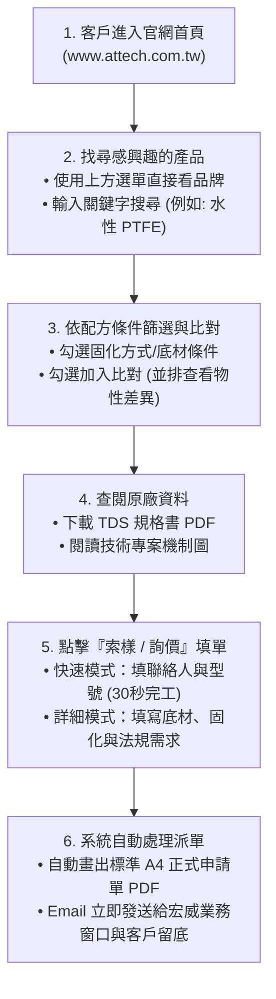
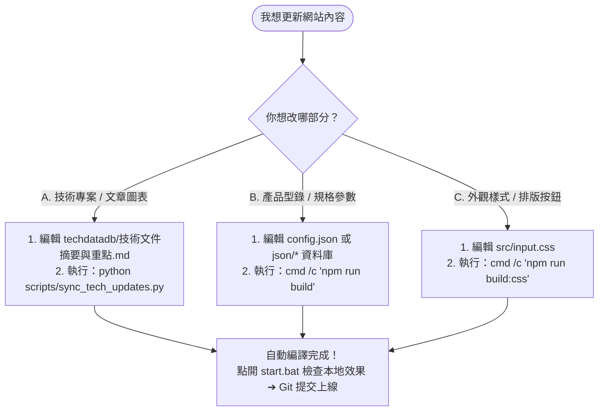
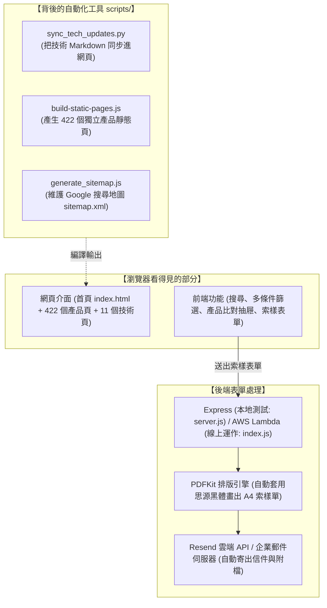

# 宏威應用材料 (ATTech) 官網維護與操作說明書

> 這是一份專為網站維護者與交接同仁撰寫的實用手冊。  
> 沒有難懂的技術黑話，只講兩件事：**這個網站是做什麼的**，以及**你想改資料時該找哪個檔案、跑哪行指令**。

---

## 快速導覽

1. [這是一個什麼樣的網站？（30 秒搞懂）](#1-這是一個什麼樣的網站30-秒搞懂)
2. [怎麼在自己的電腦打開網站？（本地測試）](#2-怎麼在自己的電腦打開網站本地測試)
3. [我想改資料，該怎麼做？（四大最常見情境）](#3-我想改資料該怎麼做四大最常見情境)
   - [情境一：修改或新增「技術文章 / 原理圖」](#情境一修改或新增技術文章--原理圖)
   - [情境二：修改或新增「產品規格 / 型號」](#情境二修改或新增產品規格--型號)
   - [情境三：修改網頁外觀樣式 (CSS)](#情境三修改網頁外觀樣式-css)
   - [情境四：測試「索樣表單寄信與產出 PDF」](#情境四測試索樣表單寄信與產出-pdf)
4. [清晰圖解流程圖](#4-清晰圖解流程圖)
   - [圖一：客戶在網站上的操作流程](#圖一客戶在網站上的操作流程)
   - [圖二：維護人員更新網站的作業流程](#圖二維護人員更新網站的作業流程)
   - [圖三：系統各模組分工概覽](#圖三系統各模組分工概覽)
5. [檔案都在哪裡？（重要資料夾白話導覽）](#5-檔案都在哪裡重要資料夾白話導覽)
6. [常碰到的問題與排錯 (FAQ)](#6-常碰到的問題與排錯-faq)

---

## 1. 這是一個什麼樣的網站？（30 秒搞懂）

這是**宏威應用材料 (ATTech)** 的官方產品展示與索樣平台，主要服務對象為塗料、油墨、樹脂配方工程師與採購人員。

網站主要有四大功能：
1. **看產品**：收錄 **Micro Powders**（微粉蠟）、**Dorf Ketal**（有機鈦/鋯催化劑、擴鏈劑）、**Orion**（碳黑）及**特用助劑**（消光粉、樹脂、矽烷等）等四大原廠產品。
2. **查規格與比對**：客戶可以依據「水性/溶劑型/UV固化」、「乾燥條件」或關鍵字篩選產品，最多還能挑選 4 款產品並排對比物性。
3. **看技術文件**：整理了 11 大特用化學品專題，內含原廠反應機制圖與說明文件。
4. **線上索樣（自動派信）**：客戶線上填寫需求單送出後，系統後端會**自動繪製一張 A4 單頁的正式 PDF 申請單**，並寄發 Email 同步通知業務窗口（`sales1@attech.com.tw` / `service@attech.com.tw`）與客戶。

---

## 2. 怎麼在自己的電腦打開網站？（本地測試）

平常要在自己的 Windows 電腦檢查網站是否正常，**完全不需要打指令，點滑鼠兩下即可**：

### 🟢 啟動網站
* 找到專案根目錄的 **`start.bat`**（或 `start_server_9118.bat`），**滑鼠左鍵點兩下執行**。
* 畫面會彈出一個黑底終端機視窗，同時會**自動打開瀏覽器**進入：[http://localhost:9118](http://localhost:9118)。
* 只要該黑底視窗開著，網站就可以一直點擊測試。

### 🔴 關閉網站
* 測試完畢後，直接點兩下根目錄的 **`stop_server_9118.bat`**。
* 系統會自動把佔用 Port 9118 的伺服器關閉，避免下次打不開。

---

## 3. 我想改資料，該怎麼做？（四大最常見情境）

這是平時維護最常遇到的四種情境，只要按照對應步驟做即可：

```
+-------------------------------------------------------------------------------+
|  你想改什麼？            要改哪個檔案？                   最後在終端機跑哪行指令？        |
+-------------------------------------------------------------------------------+
|  1. 技術文章或原理圖片   techdatadb/技術文件摘要與重點.md   python scripts/sync_tech_updates.py
|  2. 產品規格或新增型號   config.json 與 json/ 資料夾       cmd /c "npm run build"
|  3. 網頁排版樣式         src/input.css                   cmd /c "npm run build:css"
|  4. 測試索樣表單寄信     index.js (若有改程式)             node scripts/test-lambda.js --local
+-------------------------------------------------------------------------------+
```

---

### 情境一：修改或新增「技術文章 / 原理圖」

> **例子**：你想修改 Tyzor 或碳黑的文字重點、新增一篇應用文獻、或者替換作用原理圖片。

* **第一步：打開文檔修改**  
  用編輯器打開這個檔案：  
  👉 `techdatadb/技術文件摘要與重點.md`  
  直接在裡面修改文字或重點。若要加圖片，把圖檔放在 `techdatadb/` 相應目錄下，並在文檔中標註圖片路徑。
* **第二步：跑一行指令自動同步**  
  在終端機（Terminal）輸入並按 Enter：
  ```bash
  python scripts/sync_tech_updates.py
  ```
* **結果**：  
  這個腳本全自動幫你做好所有事：它會把 Markdown 的內容解析成資料庫、同步更新 `js/technology.js`、並重新生成 11 個技術子頁面（`technology/*/index.html`）與首頁。你手動設定的圖片絕對不會被覆蓋。

---

### 情境二：修改或新增「產品規格 / 型號」

> **例子**：代理品牌出了新產品，或某個產品的熔點、黏度數值修正。

* **第一步：修改產品 JSON 檔案**  
  產品的設定集中在：  
  👉 總分類清單：`config.json`  
  👉 各品牌詳細規格：`json/mpi/`、`json/dorfketal/`、`json/orion/`、`json/others/` 裡面的 JSON 檔。  
  找到對應型號直接修改數值。若要加原廠 TDS 規格書，把 PDF 放到 `tds/` 資料夾。
* **第二步：跑指令重新產生網頁**  
  在終端機輸入：
  ```cmd
  cmd /c "npm run build"
  ```
* **結果**：  
  系統會自動為 400 多款產品重新產生獨立的靜態網頁（放在 `products/` 目錄），並更新搜尋引擎地圖 `sitemap.xml`。

---

### 情境三：修改網頁外觀樣式 (CSS)

> **例子**：修改按鈕顏色、調整字體大小或版面間距。

* **第一步：修改樣式源碼**  
  修改檔案：👉 `src/input.css` 或直接在 HTML / JS 中加入 Tailwind class 名稱。
* **第二步：重新編譯樣式檔**  
  在終端機輸入：
  ```cmd
  cmd /c "npm run build:css"
  ```
  *(如果是正在一邊寫程式一邊看效果，可以輸入 `cmd /c "npm run dev"`，它會即時監控檔案變動自動編譯)*

---

### 情境四：測試「索樣表單寄信與產出 PDF」

> **例子**：你想確認客戶在網頁上填表單後，寄給業務的信件長怎樣、產出的 PDF 申請單是否排版整齊。

* **第一步：在本機跑模擬測試**  
  在終端機輸入：
  ```bash
  node scripts/test-lambda.js --local
  ```
* **第二步：檢查產出的 PDF**  
  測試完成後，去 `scratch/` 資料夾看看，系統剛生出了兩份 PDF（快速模式與詳細模式），打開檔案即可確認字體與排版是否完美。

> [!IMPORTANT]
> **測試寄信鐵則**：如果是要透過網頁實際發送測試郵件，依據專案規範，**「公司名稱」與「聯絡人」一律必須填寫「測試中」**，避免業務同仁誤認為是真實客戶案件！

---

## 4. 清晰圖解流程圖

以下三張圖用最直觀的方式展示網站運作：

### 圖一：客戶在網站上的操作流程



---

### 圖二：維護人員更新網站的作業流程



---

### 圖三：系統各模組分工概覽



---

## 5. 檔案都在哪裡？（重要資料夾白話導覽）

當你想找某個檔案時，看這張對照表最快：

| 資料夾 / 檔案 | 裡面放什麼？ | 什麼時候會用到？ |
| :--- | :--- | :--- |
| **`techdatadb/`** | 放技術專區的 Markdown 原稿、以及各原廠的作用機制圖片。 | 要改技術文章文字、換原理示意圖時來這裡。 |
| **`json/`** | 存放所有產品的結構化規格資料庫（MPI、Dorf Ketal、Orion 等）。 | 某款產品的黏度、比重、熔點需要改數值時來這裡。 |
| **`tds/`** | 存放各產品的原廠規格書 PDF 檔案。 | 客戶反映規格書要更新、或是新增產品 TDS 時放這裡。 |
| **`img/`** | 網站全域用到的圖示、Logo、輪播 Banner 圖片。 | 要換網站 Logo 或首頁圖檔時來這裡。 |
| **`products/`** | 自動編譯產生出的 422 個產品靜態網頁（由腳本產生）。 | 純產出物，平常不需要手動修改裡面的 HTML。 |
| **`technology/`** | 自動編譯產生出的 11 大技術專案靜態網頁（由腳本產生）。 | 純產出物，平常請改 `techdatadb`，不要手動改這裡。 |
| **`scripts/`** | 網站的所有自動化建置工具（同步腳本、頁面生成、打包工具）。 | 執行維護指令時調用，內部已有詳細說明。 |
| **`doc/`** | 官方說明文件、樣品申請單 Word/PDF 空白範本、產品確認總清單。 | 查閱業務表單範本或交付交接文檔時使用。 |
| **`start.bat`** | 本機啟動網站測試的 Windows 批次檔。 | 想要在自己電腦上看網站時點它。 |
| **`stop_server_9118.bat`** | 本機關閉網站的 Windows 批次檔。 | 測試完要關閉伺服器時點它。 |

---

## 6. 常碰到的問題與排錯 (FAQ)

### Q1：我明明改了 `techdatadb/技術文件摘要與重點.md`，為什麼打開網站看沒變？
* **原因**：Markdown 是資料的「源頭」，不是網頁本身。瀏覽器看的是編譯後的檔案。
* **解決方式**：改完文檔後，一定要在終端機跑一次：
  ```bash
  python scripts/sync_tech_updates.py
  ```
  跑完後重整網頁，剛改的內容就會立刻出現。

### Q2：我在 PowerShell 跑 `npm run build` 出現紅字錯誤（執行原則限制）？
* **原因**：Windows PowerShell 預設安全原則禁止執行腳本。
* **解決方式**：不要直接打 `npm run build`，改在前面加上 `cmd /c`：
  ```cmd
  cmd /c "npm run build"
  ```
  或者打開一般的「命令提示字元 (CMD)」視窗來執行。

### Q3：改完網頁發布後，客戶的瀏覽器一直看到舊版畫面？
* **原因**：客戶的電腦或瀏覽器暫存（快取 Cache）了舊的 JS/CSS 檔案。
* **解決方式**：在終端機跑快取破壞腳本，後面帶入今天日期：
  ```bash
  python scripts/update_cache_version.py 20261103_v1
  ```
  系統會自動替全站所有檔案加上版本號，強制所有客戶的瀏覽器下載最新版。

### Q4：根目錄看到的 `start_server_9118.bat` 和 `stop_server_9118.bat` 是做什麼的？
* **說明**：這是專為這個專案配置的本地測試工具。
  * `start_server_9118.bat`：固定在電腦的 9118 連接埠開服，自動帶起瀏覽器。
  * `stop_server_9118.bat`：如果終端機不小心直接按叉叉關掉、導致後台伺服器卡住佔用端口時，點它一下就會乾淨清除後台進程。

---

*宏威應用材料有限公司 (ATTech Materials Co., Ltd.) — 系統管理團隊*
