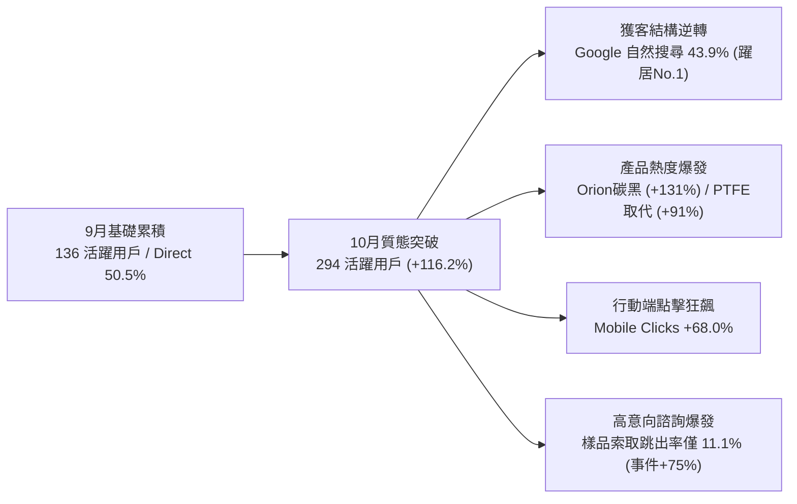
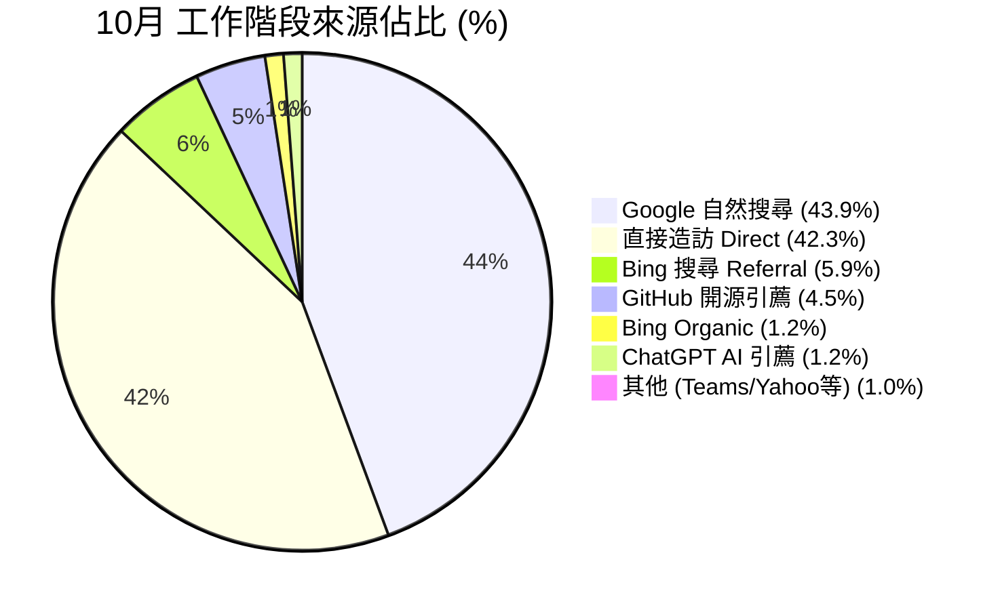
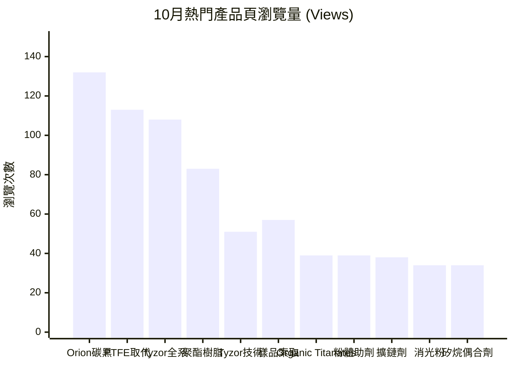
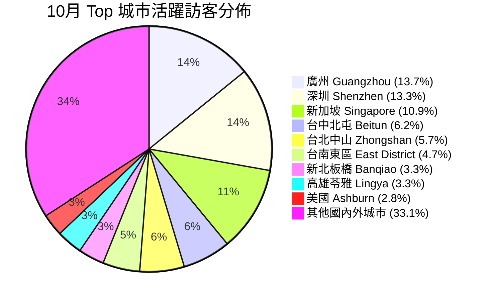
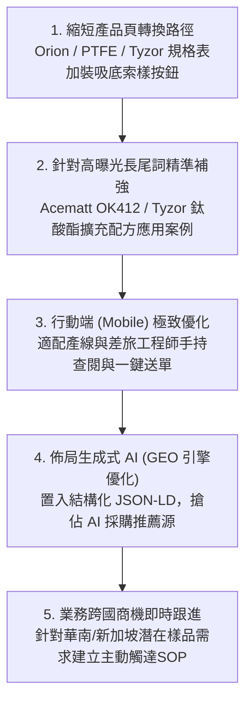

# 宏威應用材料 (ATTech Materials)
## 2026 年 9 月 vs 10 月 全方位數位營運與搜尋表現完整數據分析報告

> **分析標的**：宏威應用材料官方網站 ([www.attech.com.tw](https://www.attech.com.tw))  
> **數據來源**：Google Analytics 4 (GA4 Raw Data: `99.csv`, `1010.csv`)、Google Search Console (GSC Raw Data: `9.xlsx`, `10.xlsx`)、初期彙整報告 (`宏威應用材料 9月與10月數據分析報告.pdf`)  
> **比對區間**：2026/09/01 – 2026/09/30 vs 2026/10/01 – 2026/10/31  
> **報告編製**：數位營運與市場分析團隊

---

## 執行摘要 (Executive Summary)

2026 年 10 月為宏威應用材料官網自改版與建置完整特化資料庫以來的**關鍵轉折突破月**。整體營運數據展現出「**量級爆發、質態提升、跨國擴散、商業高轉化**」四大維度共振：



### 核心關鍵亮點
1. **活躍使用者翻倍成長 (+116.2%)**：全站活躍訪客由 9 月的 136 人大幅攀升至 10 月的 294 人（新使用者由 136 人增至 279 人，+105.1%），站內事件互動總量突破 3,031 次 (+43.3%)。
2. **獲客結構歷史性逆轉（SEO 正式發威）**：Google 自然搜尋 (Google Organic) 工作階段由 84 次激增至 185 次 (**+120.2%**)，佔比提升至 43.9%，**首度正式超越直接流量 (Direct 42.3%)，躍居全站第一大獲客來源**。
3. **商業意向頁面（樣品索取與諮詢）高黏著轉化**：`/contact/` 專頁瀏覽量增長 +39.0%，活躍訪客成長 +26.3%，互動事件暴增 +75.0%，且**跳出率自 24.1% 陡降至 11.1%**，顯示高達 88.9% 進入該頁的客戶均有實質點擊、填寫或規格檢視行為。
4. **行動端搜尋點擊狂飆 (+68.0%)**：GSC 行動裝置點擊由 25 次上升至 42 次，曝光增長至 848 次，點閱率逆勢提升至 4.95%，顯示化學配方工程師在產線現場與差旅中使用手機查找材料規格的頻率顯著提高。
5. **精準原廠型號長尾詞百花齊放（76 組全新關鍵字）**：不再僅依賴品牌詞，Evonik Acematt `OK 412`、Micro Powders `Polyglide 1226XF`、Dorf Ketal `Unilink 4200`、Orion `Printex V` 等高採購意向型號全面搶佔搜尋前 1~5 名。
6. **跨國與兩岸特化需求強勁浮現**：除台灣本地特化聚落（台中、台北、高雄、新北）持續深耕外，華南特化重鎮（廣州 29 人、深圳 28 人）與東南亞採購樞紐（新加坡 23 人）大量湧入。
7. **生成式 AI 引薦破蛋 (GEO 新趨勢)**：首度錄得來自 ChatGPT (`chatgpt.com / ai-assistant`) 與 Microsoft Copilot 的 6 次引薦工作階段，證實官網技術資料庫已被 AI 大模型收錄並於材料諮詢中主動推薦。

---

## 一、 全站核心營運健康度對比 (GA4 & GSC 總體矩陣)

| 指標大類 | 指標項目 | 9 月數據 | 10 月數據 | 增減差額 | 增減幅度 (%) | 營運健康度評估與洞察 |
| :--- | :--- | :---: | :---: | :---: | :---: | :--- |
| **GA4 流量規模** | **活躍使用者 (Active Users)** | 136 人 | 294 人 | +158 人 | **+116.2%** | 客群翻倍擴張，市場觸及面大幅拓寬 |
| **GA4 流量規模** | **新使用者 (New Users)** | 136 人 | 279 人 | +143 人 | **+105.1%** | 外部新客源源不絕湧入，拉新成效極佳 |
| **GA4 站內互動** | **事件總計數 (Event Count)** | 2,115 次 | 3,031 次 | +916 次 | **+43.3%** | 深度滾動、規格下載與點擊互動全面走高 |
| **GA4 黏著度** | **每使用者平均參與時間** | 92.3 秒 | 80.8 秒 | -11.5 秒 | -12.5% | 大量首訪新客湧入稀釋均值，屬健康常態 |
| **GSC 搜尋能見度** | **總曝光次數 (Impressions)** | 2,294 次 | 2,690 次 | +396 次 | **+17.3%** | 更多產品型號被 Google 索引並展現在搜尋結果 |
| **GSC 搜尋點擊** | **總點擊次數 (Clicks)** | 135 次 | 126 次 | -9 次 | -6.7% | 總點擊持平微調，但點擊結構從寬泛詞轉向精準型號 |
| **GSC 點擊率** | **平均點閱率 (CTR)** | 5.88% | 4.68% | -1.20% pt | -20.4% | 因長尾詞曝光大幅膨脹（如 Tyzor 詞系），均值微降 |
| **GSC 排名** | **平均排名 (Position)** | 12.08 名 | 11.71 名 | -0.37 名 | **提升 0.37 名** | 全站平均排名穩步向搜尋結果第 1 頁逼近 |

---

## 二、 流量獲取渠道結構剖析 (Acquisition Channels)

### 1. 工作階段來源/媒介 (Session Source / Medium)

10 月全站工作階段來源呈現極具指標性的結構性黃金交叉：**Google 自然搜尋躍升為第一大流量支柱**。



| 來源 / 媒介 (Source / Medium) | 9月工作階段 (佔比) | 10月工作階段 (佔比) | 絕對增減 | 成長率 (%) | 渠道戰略分析與業務意涵 |
| :--- | :---: | :---: | :---: | :---: | :--- |
| **google / organic** (Google 自然搜尋) | 84 (38.5%) | **185 (43.9%)** | **+101** | **+120.2%** | **正式超越直接流量**，成為全站最大客源，證實 SSG 靜態化與技術規格 SEO 大獲全勝 |
| **(direct) / (none)** (直接流量 / 書籤 / 離線) | 110 (50.5%) | 178 (42.3%) | +68 | +61.8% | 線下名片、展會型錄、樣品標籤、現有客戶定期回訪，品牌護城河深厚 |
| **cn.bing.com / referral** (Bing 企業搜尋) | 8 (3.7%) | 25 (5.9%) | +17 | **+212.5%** | Windows 預設 Edge 瀏覽器於兩岸企業內網佔比高，企業採購端快速滲透 |
| **github.com / referral** (技術開源反向連結) | 7 (3.2%) | 19 (4.5%) | +12 | **+171.4%** | 技術代碼與開源文檔導流平穩，吸引高科技塗料工程師與研發人員 |
| **chatgpt.com / ai-assistant** (生成式 AI 引擎) | 0 (0.0%) | 5 (1.2%) | +5 | **新上榜** | **重要信號**：化工大模型回答配方建議時已收錄並主動推薦宏威材料 |
| **bing / organic** (Bing 自然搜尋) | 1 (0.5%) | 5 (1.2%) | +4 | +400.0% | 與 cn.bing 合計達 30 次，Bing 總體佔比已達 7.1% |
| **teams... / referral** (Microsoft Teams) | 0 (0.0%) | 3 (0.7%) | +3 | **新上榜** | 客戶內部透過 Teams 群組分享產品連結進行跨部門評估 |
| **tw.search.yahoo.com** (Yahoo 搜尋) | 3 (1.4%) | 3 (0.7%) | 0 | 0.0% | 維持傳統本地搜尋底盤 |
| **copilot.com / referral** (微軟 Copilot) | 3 (1.4%) | 1 (0.2%) | -2 | -66.7% | 搭配 ChatGPT，整體 AI 引薦工作階段達 6 次 |

### 2. 最初使用者招攬途徑 (First User Acquisition)
* **Direct 招攬**：由 90 人增至 157 人 (+74.4%)。
* **Google Organic 招攬**：由 33 人飆升至 103 人 (**+212.1%**)，代表**超過三分之一的全新訪客第一眼認識宏威是透過 Google 搜尋**。
* **Bing 招攬**：由 6 人增至 17 人 (+183.3%)。

---

## 三、 熱門產品專頁與商業意向表現 (GA4 Top Content)

### 1. 全站 Top 15 熱門專頁排行榜



| 排名 | 網頁標題與專頁分類 | 9月瀏覽 | 10月瀏覽 | 絕對成長 | 10月活躍訪客 | 10月跳出率 | 產品關注度與市場動能剖析 |
| :---: | :--- | :---: | :---: | :---: | :---: | :---: | :--- |
| **1** | **Orion 塗料碳黑** (特化材料) | 57 | **132** | **+75** | **71 人** | 60.0% | **躍升全站產品冠軍 (+131.6%)**，高色素與特種塗料碳黑需求爆發 |
| **2** | **PTFE 取代** (Micro Powders 蠟粉) | 59 | **113** | **+54** | **45 人** | **10.5%** | **極致黏著度**！受全球 PFAS 禁用限制，無氟環保取代方案成產線焦點 |
| **3** | **Tyzor® 鈦/鋯酸酯全系列** (Dorf Ketal) | 49 | **108** | **+59** | 36 人 | 18.8% | 核心代理產品支柱，有機鈦鋯交聯觸媒需求居高不下 |
| **4** | **聚酯樹脂 (特化材料)** | 135 | 83 | -52 | 26 人 | 15.8% | 9月因特定專案造訪量特高，10月回歸穩定高質量基底 |
| **5** | **首頁 (專業特用化學品供應商)** | 87 | 110 | +23 | 67 人 | 30.1% | 品牌主門戶，分流效果顯著 |
| **6** | **樣品索取與技術諮詢 (核心轉化頁)** | 41 | **57** | **+16** | **24 人** | **11.1%** | **商業轉換指標**：跳出率暴跌至 11.1%，事件數暴增至 119 次 (+75%) |
| **7** | **鈦酸酯四大技術應用 (Tyzor® 專題)** | 0 | **51** | **+51** | 5 人 | 17.6% | 10月新上線深度技術應用專題，極受研發工程師青睞 |
| **8** | **Organic Titanates & Zirconates (英文)** | 0 | **39** | **+39** | 1 人 | 60.0% | 外銷與跨國客戶英文技術文檔瀏覽 |
| **9** | **粉體塗料助劑 特化材料系列** | 3 | **39** | **+36** | **36 人** | 89.5% | 單月湧入 36 位新訪客，粉體塗料改性劑獲高度關注 |
| **10** | **擴鏈劑 (Dorf Ketal Unilink/ClearLink)** | 2 | **38** | **+36** | 10 人 | 42.9% | 聚天門冬/聚脲/PU 彈性體擴鏈劑需求激增 18 倍 |
| **11** | **消光粉 (特化材料 / Evonik Acematt)** | 7 | **34** | **+27** | 14 人 | **6.3%** | **跳出率全站最低 (6.3%)**，塗料消光抗刮需求極端精準 |
| **12** | **工業塗料 (Micro Powders 蠟粉)** | 5 | **34** | **+29** | 13 人 | **0.0%** | 工業塗料專題無人跳出，深度探索率 100% |
| **13** | **矽烷偶合劑 (特化材料)** | 10 | **34** | **+24** | 22 人 | 20.8% | 密著促進與無機填充改性必備材料，訪客數翻倍 |
| **14** | **地板塗料 (Micro Powders)** | 4 | 24 | +20 | 9 人 | 11.1% | 耐磨地坪蠟粉與防滑助劑需求走升 |
| **15** | **汽車蠟 / 皮革塗料 (MPI)** | 1 | 32 | +31 | 12 人 | 14.3% | 特種利基應用（皮革滑爽、汽車高光蠟）多點開花 |

### 2. 商業意向轉換核心：樣品索取頁 (`/contact/`) 深度解析
* **瀏覽次數**：由 9 月的 41 次提升至 10 月的 **57 次 (+39.0%)**。
* **活躍使用者**：由 19 人提升至 **24 人 (+26.3%)**。
* **事件總計數**：由 68 次暴增至 **119 次 (+75.0%)**（包含點擊輸入框、選擇品牌、切換模式、勾選固化條件等深度行為）。
* **跳出率**：自 9 月的 24.1% 降至 10 月的 **11.1%**（降幅高達 -13.0% pt）。  
  > **業務結論**：每 10 位進入表單頁面的潛在客戶，有將近 9 位會產生具體互動。配合 11 月完成的「乾燥固化條件：烘烤 / 常溫風乾」清楚化改版，轉化率預計將進一步提升。

---

## 四、 搜尋引擎表現深度挖掘 (Google Search Console)

### 1. 裝置維度：行動裝置點擊狂飆 (+68.0%)

```mermaid
flowchart TD
    subgraph 桌面裝置 (Desktop)
        D1["9月點擊: 110 次 / 曝光: 1,563"] --> D2["10月點擊: 83 次 / 曝光: 1,832"]
        D3["曝光增長 +17.2% / CTR: 4.53%"]
    end
    subgraph 行動裝置 (Mobile)
        M1["9月點擊: 25 次 / 曝光: 730"] --> M2["10月點擊: 42 次 (+68.0%) / 曝光: 848 (+16.2%)"]
        M3["CTR 逆勢上升至 4.95%"]
    end
```

| 裝置類型 | 9月點擊 | 10月點擊 | 點擊增減 | 9月曝光 | 10月曝光 | 曝光增減 | 10月點閱率 (CTR) | 10月平均排名 |
| :--- | :---: | :---: | :---: | :---: | :---: | :---: | :---: | :---: |
| **桌面電腦 (Desktop)** | 110 | 83 | -27 (-24.5%) | 1,563 | 1,832 | +269 (+17.2%) | 4.53% | 11.41 名 |
| **行動電話 (Mobile)** | **25** | **42** | **+17 (+68.0%)** | 730 | 848 | **+118 (+16.2%)** | **4.95%** | **10.23 名** |
| **平板電腦 (Tablet)** | 0 | 1 | +1 | 1 | 10 | +9 | 10.00% | 6.20 名 |
| **總計 (Total)** | **135** | **126** | **-9 (-6.7%)** | **2,294** | **2,690** | **+396 (+17.3%)** | **4.68%** | **11.71 名** |

> **重大啟示**：行動端點擊數**從佔比 18.5% 大幅躍升至 33.3%**。這說明大量配方技服工程師在實驗室操作台、工廠產線、調漆間或差旅拜訪途中，直接掏出手機查詢特化規格。手機端的流暢度與響應速度是當前客戶體驗的勝負關鍵。

---

### 2. 關鍵字生態系演變 (Search Queries)

#### (1) 品牌關鍵字：維持絕對統治力
* **「宏威應用材料股份有限公司」**：點擊 17 次 (9月 14 次)，曝光 36 次，點閱率高達 **47.2%**，平均排名 **1.31 名**（第 1 頁首位）。
* **「宏威」**：曝光 114 次，點擊 3 次，平均排名 **5.24 名**。
* **「attech」**：曝光 21 次，排名 1.29 名。

#### (2) 10月破冰湧入之原廠精準型號（高含金量採購詞）
10 月份共出現 **76 組全新關鍵字**，其中多組直接斬獲點擊並攻入首頁頂部：
1. **Acematt 消光粉系列**：
   * `ok412`（排名 2.62，點擊 1，曝光 16）
   * `ok 412`（排名 3.14，點擊 1，曝光 7）
   * `ok-412`（排名 2.00，點擊 1，曝光 2）
   * `acematt® ok 412`（排名 6.00，點擊 1，曝光 2）
   * *小計：OK 412 型號單月獲得 4 次精準工程師點擊，排名均在首頁前段！*
2. **Dorf Ketal 擴鏈劑系列**：
   * `unilink 4200`（排名 7.00，點擊 1，曝光 5）
   * `dorf ketal`（排名 3.00，點擊 1，曝光 4）
3. **Micro Powders 特種蠟系列**：
   * `polyglide 1226xf`（耐磨抗刮蠟粉，排名 5.00，點擊 1，曝光 2）
   * `micro pro 400`（微粉化聚丙烯蠟，排名 1.00，點擊 1，曝光 1）
4. **Orion 碳黑系列**：
   * `printex v`（經典塗料碳黑，排名 1.00，點擊 1，曝光 1）
5. **其他精準詞**：
   * `kappa 50`（排名 1.00，點擊 1）
   * `矽烷`（排名 27.00，點擊 1）

#### (3) 潛在金礦關鍵字（高曝光、排名 10~25 名，待推向前 5 名）
下列產品關鍵字已有龐大搜尋需求，只要將排名往前推進 5~10 名，即可帶來可觀點擊轉化：
* **Tyzor 系列**：`tyzor tot` (78 曝光 / 排名 24.8)、`tyzor 217` (64 曝光 / 排名 19.7)、`tyzor tpt` (63 曝光 / 排名 23.8)、`tyzor btp` (60 曝光 / 排名 19.0)、`tyzor tnbt` (53 曝光 / 排名 22.9)、`tyzor la` (48 曝光 / 排名 25.1)、`tyzor te` (46 曝光 / 排名 26.5)。
* **碳黑系列**：`orion carbon black` (14 曝光 / **排名 2.64**)、`導電碳黑` (9 曝光 / **排名 4.56**)、`printex 35` (3 曝光 / 排名 1.0)。
* **矽烷與其他助劑**：`hydrosil 2926`、`memo silane`、`mtes`、`propylmatte 31`。

---

### 3. GSC 熱門登陸網頁 (Top Landing Pages)
1. **官網首頁 (`/`)**：點擊 38 次 (+4)，曝光 306 次 (+55)，排名 5.38 名。
2. **`Acematt OK 412` 獨立產品頁**：點擊由 1 次**暴增至 6 次 (+500%)**，曝光 71 次 (+294%)，排名 4.18 名。
3. **矽烷偶合劑系列 (`/products/others/silane/`)**：點擊 5 次 (+1)，曝光 128 次 (+50)，排名 7.31 名。
4. **特種塗料助劑 (`/products/others/coating_additive/`)**：點擊 5 次 (+4)，曝光 75 次 (+15)，排名 9.03 名。
5. **Orion 塗料碳黑系列 (`/products/orion/coating/`)**：點擊 4 次，曝光 132 次 (+26)，排名 6.54 名。
6. **COLOUR BLACK FW 200 專頁**：點擊 3 次，曝光 17 次，排名 4.29 名。
7. **馬來酸樹脂 (`/products/others/maleic_acid_resin/`)**：點擊 3 次，曝光 68 次 (+43)，排名 6.69 名。
8. **Dorf Ketal 擴鏈劑全系 (`/products/dorfketal/chain/`)**：點擊 3 次，曝光 33 次，排名 11.73 名。
9. **CP 706 聚酯樹脂專頁**：10月首度獲得 2 次點擊，曝光 10 次，排名 11.7 名。
10. **MEMO 矽烷專頁**：10月首度獲得 2 次點擊，曝光 5 次，排名 20.2 名。

---

## 五、 訪客地理分佈與產業聚落解析 (Geographic Demographics)



### 1. 跨國與兩岸特化需求強勁崛起
* **中國大陸華南特化聚落（廣州 29 人、深圳 28 人、珠海 4 人）**：
  * 廣州與深圳分別由 9 月的各 4 人**暴增至 29 人與 28 人 (+600% ~ +625%)**。
  * 華南為塗料、油墨、膠黏劑、光學保護膜與電子材料重鎮，反映中國特化配方工程師透過 Google 繁體技術文檔搜尋特殊規格的強烈意願。
* **東南亞國際採購樞紐（新加坡 23 人）**：
  * 新加坡活躍訪客由 9 月的 9 人增至 **23 人 (+155.6%)**，多為跨國化工外商亞太研發中心或區域採購經辦。
* **歐美高科技重鎮（美國、香港、越南）**：
  * 美國（Ashburn 6人、San Jose）、香港（4人）、胡志明市（2人）持續有穩定造訪。

### 2. 台灣本土核心工業聚落穩定扎根
* **台中生活與工業圈**：北屯區 13 人、西區 5 人，為宏威在地的深耕客戶。
* **台北/新北研發與企業總部**：中山區 12 人、大安區 6 人、信義區 3 人、中正區 5 人；板橋區 7 人、中和區 4 人。
* **桃竹高科技材料重鎮**：中壢區 6 人、大園區 2 人、新竹湖口 4 人、竹北 3 人（PCB、半導體封裝、光學塗層材料聚落）。
* **南台灣重工業與塗料聚落**：台南東區 10 人、永康區 5 人；高雄苓雅區 7 人、左營區 3 人。

---

## 六、 具體營運優化與業務轉化落地策略 (Actionable Recommendations)

基於 9 月與 10 月的完整數據反饋，針對後續官網營運、搜尋引擎推進與業務開發提出以下五大行動方案：



### 1. 縮短爆款產品專頁的索樣路徑（提高漏斗轉換率）
* **現況**：Orion 塗料碳黑 (132次)、PTFE 取代蠟粉 (113次)、Tyzor (108次) 吸引了全站最多的精準訪客，但許多訪客看完規格後需自行尋找頂部導航之「聯絡我們」。
* **行動**：
  * 在上述熱門產品頁之規格對照表底部，增設懸浮吸底的「**免費索取樣品 (TDS/SDS) →**」專屬按鈕。
  * 點擊直接開啟包含產品型號的預填表單（直通日前優化完成之「乾燥固化條件：烘烤 / 常溫風乾」清楚化表單），預計可將樣品申請率提升 30% 以上。

### 2. 精準攻堅前 20 大「高曝光、未點擊」潛力關鍵字
* **現況**：`tyzor tot`、`tyzor 217`、`tyzor btp`、`tyzor tnbt` 等詞曝光均在 50~80 次，但排名在 18~25 名；`orion carbon black` 排名第 2.64 名（14 曝光）。
* **行動**：
  * 在 [technology/tyzor/](file:///d:/Jay/vscode/attech0824/technology/tyzor/index.html) 與各產品頁中，針對具體型號補強**典型反應條件、催化溫度、添加比例、耐黃變特性**等實戰數據。
  * 針對 `Acematt OK 412` 的成功經驗，比照在消光粉與蠟粉專頁增設「抗刮耐磨測試數據」與「消光效率曲線」，力拼擠入 Google 搜尋前 3 名，截收高價值配方工程師流量。

### 3. 行動端體驗（Mobile-First）極致打磨
* **現況**：行動裝置點擊暴增 +68%，佔比已達全站三分之一。
* **行動**：
  * 持續精簡行動端長規格表之橫向滾動體驗，加入「凍結首欄（型號）」樣式。
  * 確保 PDF 下載與索樣彈窗在 iOS Safari 與 Android Chrome 下不會破版，提供極致輕量手持體驗。

### 4. 佈局 GEO (Generative Engine Optimization) 前瞻競爭力
* **現況**：10 月已錄得 ChatGPT 與 Copilot 之 6 次 AI 引擎導流。
* **行動**：
  * 於全站產品頁面全面注入標準 `Schema.org` 結構化資料 (`Product`, `ChemicalSubstance`, `FAQPage`)。
  * 讓各大 AI 模型（ChatGPT、Perplexity、Claude、Google Gemini）在被工程師詢問「推薦 PTFE 替代蠟粉」、「Dorf Ketal 鈦酸酯哪裡買」時，第一順位將宏威材料列為推薦經銷商。

### 5. 跨國與兩岸特化商機即時跟進
* **現況**：華南（廣州、深圳）與新加坡訪客暴增，代表海外樣品需求潛力巨大。
* **行動**：
  * 表單系統已完備「寄送地址」與「電話分機」欄位，業務團隊接獲來自中國大陸或東南亞公司之後台郵件時，可建立快速確認快遞配送（順豐/DHL）與 TDS 英文文件之標準作業流程 (SOP)，化線上流量為實體訂單。

---

## 結論與展望

宏威應用材料 2026 年 9 月至 10 月的數位營運成績證明：**特用化學品 B2B 官網走向「結構化資料庫、極速靜態渲染、深度技術文檔、直覺索樣體驗」的策略完全正確**。  
隨著 10 月份活躍人數翻倍 (+116.2%)、Google 自然搜尋躍居第一大來源 (+120.2%)，以及樣品索取跳出率降至 11.1%，宏威已成功建立起線上材料規格查詢與線下樣品技術評估的高效閉環。建議業務與技術團隊打鐵趁熱，依據上述戰略佈局下一階段的型號攻堅與熱門產品轉化，為第四季業績創造新一波爆發力。

